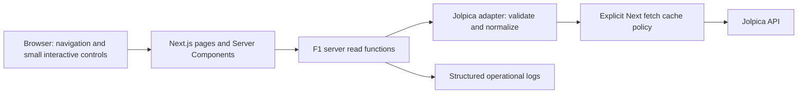

# System architecture

**Status: proposed design for review, 2026-10-18.** The clarified audience is
public from the first release, with future personalized and premium tools.
Vercel is the confirmed initial host. The system should support the
[first-release requirements](requirements.md) without introducing a second runtime
or persistent application database merely in anticipation of growth.

## Approaches considered

| Approach                                            | Benefit                                                                           | Cost / limitation                                                                                               | Recommendation                                       |
| --------------------------------------------------- | --------------------------------------------------------------------------------- | --------------------------------------------------------------------------------------------------------------- | ---------------------------------------------------- |
| One Next.js app with server-side data modules       | Uses the current stack, one deployable, shared types, centralized provider access | Web runtime limits heavy analysis; hosting cache semantics need verification                                    | Start here                                           |
| Static site with scheduled data generation          | Small serving footprint; few runtime dependencies                                 | Requires a publication pipeline; updates depend on successful generation; weaker fit for later interactive data | Reconsider if the product becomes an archival site   |
| Next.js plus independent API and ingestion services | Independent scaling and room for Python workloads                                 | Multiple deployables, network contracts, monitoring, and failure modes before they are useful                   | Introduce only for measured workload or client needs |

## Proposed first-release system

The diagram below remains the minimal direct-provider implementation option.
Supabase is now the preferred backend candidate, but its initial role needs a focused
decision: retain direct cached reads, or introduce durable validated snapshots and
one refresh owner. Do not implement both paths speculatively or duplicate ingestion
across Next.js and Supabase. If snapshots are selected, revise the diagram, adapter
location, and data contracts before implementation.



The cache box represents framework-managed fetch caching, not an additional service.
The browser receives normalized view data and rendered UI, never provider credentials.
Server Components call server read functions directly; they do not make HTTP calls to
the application's own API. Add a Route Handler only when there is an actual browser
fetch, external consumer, or streaming requirement. No first-release HTTP API is
required for server-rendered navigation.

## Responsibilities and proposed structure

Create folders as their first feature is implemented; this is not a scaffolding list.

```text
src/
  app/                          # Route entry points, layouts, loading/error UI
    page.tsx                    # Overview (currently a placeholder)
    f1/[season]/...              # Calendar, weekend, results, standings
  features/f1/
    types.ts                    # Only the domain/view contracts actually consumed
    components/                 # F1 tables, schedule views, status presentations
    server/
      queries.ts                # getSchedule, getResults, getStandings
      jolpica.ts                # Fixed upstream URLs, parsing, normalization, cache options
  components/                   # UI reused by more than one feature
docs/                           # Intent, requirements, maps, decisions, onboarding
```

Keep provider payload types and identifiers inside the adapter. Read functions
expose the small normalized contracts in [data contracts](data-contracts.md).
Pages validate route inputs and compose views; shared server functions also enforce
their input bounds so future callers cannot bypass them. UI components do not import
provider transport code. Mark server-only modules using the framework-supported
boundary guard when implementing them.

Use plain modules and explicit functions. A provider interface, dependency-injection
container, shared monorepo package, generic repository layer, or global state store
is not justified by one provider and one series. Extract duplication when two real
consumers establish the common behavior. Keep F1-specific scoring and session kinds
local when another series is added.

## Framework and cache decision

Retain Next.js for a single application with public and protected surfaces. Public
content should arrive as useful HTML, using prerendering and shared caching where
appropriate. Keep interactive tables, time-zone controls, and later charts in focused
Client Components. Load large analytics dependencies only on the routes that use them.
Server rendering every request is not a goal; fast initial content and controlled
freshness are. A React Router SPA was considered during discussion, but does not
provide the desired public rendering strategy on its own; a switch to React Router
with SSR is not currently justified.

Future private routes need identity, resource authorization, and paid entitlement
checks where applicable. Enforce these at the data/API boundary, including artifact
downloads. Shared public caches must not hold user-specific or access-restricted
responses. A public preview and the protected tool can live in the same Next.js app;
route separation or a hidden UI alone is not authorization.

The installed Next.js documentation is the version authority, per [AGENTS.md](../AGENTS.md).
The inspected guides are:

- `node_modules/next/dist/docs/01-app/01-getting-started/06-fetching-data.md`
- `node_modules/next/dist/docs/01-app/01-getting-started/15-route-handlers.md`
- `node_modules/next/dist/docs/01-app/01-getting-started/08-caching.md`
- `node_modules/next/dist/docs/01-app/02-guides/caching-without-cache-components.md`

They state that fetches and Route Handlers are not cached by default. The current
config does not enable Cache Components. Proposed first slice: retain that config
and use explicit fetch revalidation options from the applicable guide. Do not mix
examples from the Cache Components model into this setup. If adopting that model
later, review its configuration, streaming, and invalidation requirements together.

Cache identity includes the provider endpoint, season, round, session kind, and
pagination inputs as applicable. Deduplication within a render is not durable
caching. A process-local map is not shared across replicas. Verify warm/cold cache,
revalidation, and outage behavior in the chosen hosting runtime before public use.
Stale data is only available while a usable cached response exists; first load,
eviction, or redeploy can instead produce the explicit unavailable state.

## Deployment and growth

Start with local development and deploy the Next.js application to **Vercel**, as
selected by the owner. A project, paid plan, deployment, and spend ceiling have not
been provisioned or approved by this choice. Pin and test a common Node version,
and verify cache behavior, failure handling, and rollback on the deployed runtime.
AWS remains an optional later worker target if a measured workload warrants it;
there is no initial AWS deployment requirement.

| Observed need                                                   | Small next step                                                                                    | Avoid until needed                                             |
| --------------------------------------------------------------- | -------------------------------------------------------------------------------------------------- | -------------------------------------------------------------- |
| Repeated slow reads or provider throttling                      | Inspect cache hit behavior, query volume, pagination, and duplicate requests first                 | Adding replicas that multiply upstream traffic                 |
| Several replicas cannot share adequate provider caching         | Use the host's supported shared cache; evaluate a managed key-value cache if necessary             | A custom distributed cache framework                           |
| Persisted preferences, fantasy entries, or durable snapshots    | Add a relational database such as PostgreSQL, schema migrations, and backup/restore checks         | Storing every telemetry sample in relational tables by default |
| Telemetry fetch/analysis exceeds request or payload budgets     | Persist bounded artifacts; move work into a background worker; add Python only if FastF1 is needed | A Python API for ordinary schedule/results reads               |
| Concurrent long-running analyses need retries and deduplication | Add a queue, idempotent jobs, and status reads                                                     | A queue for simple cached reads                                |
| Many live viewers multiply source subscriptions                 | One ingestion process per source/session and shared delivery, with reconnect/resume semantics      | One upstream subscription per viewer                           |
| A second series is ready                                        | Add its adapter and feature module, extract only proven shared concepts                            | Universal motorsport schema in phase one                       |
| A second independent client needs stable HTTP contracts         | Add a small versioned API surface over existing services                                           | GraphQL or separate API deployment by default                  |

## Security, reliability, and testing

Allowlist provider hosts and query shapes; never proxy arbitrary URLs supplied by
the browser. Validate external JSON and normalize missing values. Bound response
size, pagination, timeouts, and later telemetry date/sample ranges. Keep secrets in
server-side configuration and render external content as text or vetted links.

Independent overview sections can fail independently. Do not replace errors with
empty arrays or overwrite good cached data with invalid payloads. Log failures with
enough context to diagnose them without exposing credentials. On any future
authenticated feature, authorization and user-specific cache isolation become
requirements before release.

Test adapters with recorded fixtures and malformed payloads, service behavior for
missing/stale/failed data, and the principal user journeys in a browser. Do not
test implementation details just to raise coverage. The [developer guide](development.md)
defines the change workflow, and the [roadmap](roadmap.md) records decisions still
needed before implementation.
