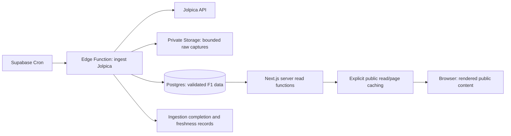

# System architecture

**Approved direction, 2026-10-19; not implemented.** One Next.js application on
Vercel, with Supabase owning durable F1 data and scheduled ingestion. Build the
public frontend outline with fixtures first. Backend implementation follows approval
of the outline and view contracts; see the [roadmap](roadmap.md).

## Approved stack

| Area                | Choice and responsibility                                 | Introduce when                                 |
| ------------------- | --------------------------------------------------------- | ---------------------------------------------- |
| Web                 | Existing Next.js App Router, React, TypeScript, Tailwind  | Frontend foundation                            |
| Hosting             | Vercel                                                    | Preview and release setup                      |
| Database            | Supabase Postgres, migrations, explicit grants and RLS    | Backend foundation                             |
| Data access         | `supabase-js` and generated database types                | Backend foundation                             |
| Ingestion           | Supabase Cron and bounded TypeScript Edge Functions       | Backend foundation                             |
| Provider validation | Zod at the upstream boundary                              | First Jolpica adapter                          |
| Raw captures        | Private Supabase Storage with bounded retention           | Ingestion implementation                       |
| Logging             | Structured JSON in Vercel and Supabase logs               | Each runtime's first feature                   |
| Errors              | Sentry for browser/server exceptions and release context  | Before public launch                           |
| Tests               | Vitest, native Deno tests, database/RLS tests, Playwright | Alongside the relevant layer                   |
| Delivery            | GitHub Actions, Vercel previews, Supabase CLI             | Frontend CI early; backend CI/CD after outline |

Keep the existing package versions until a deliberate compatibility review. Pin a
supported Node runtime before CI/deployment setup; Edge Functions run on Deno.
Auth, Realtime, Stripe, chart libraries, AI providers, and workers remain future
feature choices. Dedicated OpenTelemetry setup and Grafana are deferred. No AWS
infrastructure, independent API service, production containers, or workspace-package
monorepo tooling is required initially. One repo contains two deployment targets:
the web application and Supabase backend resources.

## First-release system



Supabase ingestion is the single owner of provider calls. Public page requests read
stored validated data; they do not fetch Jolpica on cache misses. This supersedes
the earlier direct-provider fetch-cache option. Existing data survives an upstream
outage, subject to database availability and the display freshness policy.

Jobs validate bounded pages, save private raw captures, and publish complete valid
resource snapshots atomically. Use idempotent keys, prevent overlapping refreshes,
and retain the last good snapshot when fetching or validation fails. Configure raw
capture size/retention and failure behavior before deployment; Storage and database
writes are not one transaction. Record actual job completion, not just Cron dispatch.

Server Components call internal read functions directly. Use Route Handlers only
for a concrete browser, external-client, or streaming requirement. No mandatory
public HTTP API is needed for server-rendered first-release navigation. Ingestion
functions are authenticated backend endpoints, not public read APIs.

## Responsibilities and proposed structure

Create folders as their first feature is implemented. Comments labelled later are
future boundaries, not a request to scaffold empty modules.

```text
src/
  app/
    layout.tsx                  # Shared root shell
    (public)/
      layout.tsx                # Public navigation and footer
      page.tsx                  # /
      f1/[season]/...           # Calendar, weekend/results, standings
      # Later: features/, pricing/
    (auth)/                     # Later: sign-in and callbacks
    (private)/
      app/                      # Later: /app authenticated workspace
        layout.tsx
        # telemetry/, analytics/, fantasy/, settings/
  features/
    f1/
      schedule/                 # Components, view contracts, server reads
      results/
      standings/
    # Later: telemetry/, analytics/, fantasy/, account/, billing/
  components/                   # Reused UI and navigation
  lib/
    supabase/                   # Runtime-appropriate client factories
    observability/
    # Later: auth/, entitlements/
  types/database.generated.ts   # Introduced with the database
supabase/
  migrations/
  functions/
    _shared/                    # Only genuinely shared function logic
    ingest-jolpica/              # Provider adapter and ingestion entry point
  tests/                        # Database/access-policy tests
tests/
  fixtures/                     # Deterministic normal and failure scenarios
  e2e/
.github/workflows/
docs/
```

Route groups `(public)`, `(auth)`, and `(private)` do not appear in URLs. The real
`app/` segment under `(private)` creates `/app/...`. Feature modules follow domains,
not access tiers: public previews and protected tools can share presentation and
domain logic. Shared UI must not import privileged server or ingestion modules.

The future private layout provides an authenticated shell. Identity, resource
ownership, and paid entitlements are enforced at server/data boundaries as well.
Signed-in access does not imply paid access. Do not cache private responses in
shared public caches. Use least-privilege public read grants/RLS; restrict ingestion
writes and raw captures. Generated database types are not input validation or an
access-control mechanism.

## Frontend-first contracts

The first two phases use realistic fixtures matching the [read contracts](data-contracts.md).
Keep fixtures outside production provider logic, with an explicit development/test
selection that cannot silently serve sample results in production. Validate routes,
mobile/keyboard behavior, and unavailable/stale/partial states before schema design.
Connect calendar, then results, then standings as vertical slices. Do not wait for
future telemetry or fantasy interfaces before integrating real data.

## Rendering and cache policy

Public pages deliver useful server-rendered or prerendered HTML; focused Client
Components handle time zones, controls, and later charts. Keep the installed cache
model (Cache Components currently disabled). Cache the stored-data read/render with
explicit timed revalidation; do not assume Supabase client reads are automatically
cached. Verify the concrete cache primitive against installed Next.js docs when
implementing it. Add ingestion-triggered invalidation only if freshness requires it.

The ingestion schedule and page-cache lifetime are separate. End-to-end freshness
includes both, plus provider publication delay. Preserve original retrieval and
snapshot timestamps through caching. A cache miss reads Postgres, and page refresh
never forces an unbounded provider import. See [freshness policy](data-contracts.md#freshness-and-failure-policy).

## Deployment and growth

[Operations and testing](operations.md) owns environment boundaries, CI/CD ordering,
logging, monitoring, and release checks. Budget, hosting tiers, deployment region,
and concrete freshness thresholds must be resolved before provisioning/release.
The approved stack does not authorize purchases or claim services are configured.

| Observed need                                           | Next step                                                                      |
| ------------------------------------------------------- | ------------------------------------------------------------------------------ |
| Slow pages or excessive database reads                  | Inspect queries, indexes, payloads, and cache behavior                         |
| Heavy telemetry exceeds function budgets                | Benchmark bounded jobs; introduce a worker and artifact storage when justified |
| Concurrent background work needs durable retries        | Add a queue and job status model                                               |
| Live viewers need shared updates                        | One ingestion owner per source/session; shared delivery and reconnect behavior |
| A second series has verified data                       | Add its adapter and module; extract proven common concepts                     |
| Another client needs stable HTTP contracts              | Add a documented API over existing services                                    |
| Cross-runtime incident diagnosis exceeds platform tools | Add sampled OpenTelemetry and evaluate managed Grafana                         |

Supabase Edge Functions have CPU and duration limits; do not assume a paid plan
makes heavy computation suitable. Keep batch work bounded and validate actual
runtime behavior before choosing a future telemetry execution environment.
