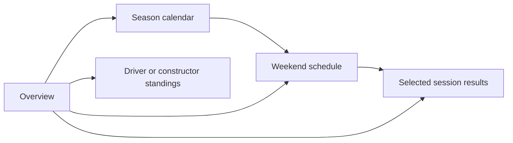

# User flows and route map

**Status: proposed.** Only `/` currently exists, as a placeholder. The paths below
are design contracts, not available endpoints. Use an explicit `f1` namespace now
to avoid ambiguous links when another series arrives; do not build a generic series
framework before a second series has real requirements.

## Surfaces

| Route                                             | Surface and primary action                                         | Server read                                        | Requirements |
| ------------------------------------------------- | ------------------------------------------------------------------ | -------------------------------------------------- | ------------ |
| `/`                                               | Lightweight overview; open next weekend or latest available result | Schedule, latest result summary, standings summary | F1-01, F1-07 |
| `/f1/[season]/calendar`                           | Browse calendar; select weekend                                    | `getSchedule(season)`                              | F1-02, F1-03 |
| `/f1/[season]/weekends/[round]`                   | Weekend schedule; choose result session                            | `getSchedule(season)` filtered by round            | F1-02, F1-04 |
| `/f1/[season]/weekends/[round]/results/[session]` | Read race, qualifying, or sprint classification                    | `getResults(season, round, session)`               | F1-04        |
| `/f1/[season]/standings?category=drivers`         | Switch drivers/constructors and season                             | `getStandings(season, category)`                   | F1-05, F1-06 |

`session` accepts only `race`, `qualifying`, or `sprint` in the first release.
`category` accepts `drivers` or `constructors`, defaulting to `drivers` when omitted.
An invalid category shows a correction link; an invalid path parameter produces a
not-found page without an upstream call. A valid weekend with unavailable results
shows a publication/coverage state, not a not-found page. Confirm calendar membership
before treating a syntactically valid round as an existing weekend.

## Homepage and future premium surfaces

**Direction approved by the owner on 2026-10-18; not implemented:** `/` is a public dashboard homepage in the same Next.js application,
combining a short explanation of PaddockView with useful F1 content. It does not
require an account, and visitors do not need to pass through a separate marketing
landing page to reach results or schedules.

Recommended content order: a concise heading/introduction, the next race weekend
and session times, latest available results, standings summaries, and links to the
full calendar and detail pages. Add articles or news only when that feature exists.
Keep the primary content server-rendered or prerendered and shared across visitors;
personalized controls must not make the entire public page depend on authentication.

| Homepage area         | What it contains                                                                  | Purpose                                                                                                                  |
| --------------------- | --------------------------------------------------------------------------------- | ------------------------------------------------------------------------------------------------------------------------ |
| Header                | Logo/home link, Calendar, Results entry, Standings; mobile navigation when needed | Direct access for returning visitors; Results can link to the latest available result until a results index is justified |
| Compact introduction  | One clear heading and a short explanation of the dashboard                        | Explain the product without pushing useful content below a large promotional hero                                        |
| Next weekend          | Event/circuit, next session, labelled local time, link to the weekend schedule    | Answer what is happening next; show an explicit offseason/unavailable state when applicable                              |
| Latest results        | A short classification preview, session identity, and full-results link           | Let visitors catch up without rendering a complete results page on the homepage                                          |
| Championship overview | Driver and constructor summaries with as-of round and full-standings links        | Show championship context without overcrowding the page                                                                  |
| Footer                | Source attribution, unofficial-project disclaimer, relevant project information   | Explain provenance and make limitations easy to find                                                                     |

On mobile, stack these sections in the same priority order; on wider screens,
results and standings can sit side by side. The exact visual layout is still to be
designed. Add editorial coverage and premium previews only once there is real
content or a working feature to link to. Logged-in visitors can later use a separate
workspace entry without changing the core public content or its canonical URL.

SEO applies to each public content page, not only the homepage. Give weekend and
results pages stable canonical URLs, helpful context, sources, and clear internal
links. Do not create thin marketing copy solely to fill a landing page. This follows
[Google's useful-content guidance](https://developers.google.com/search/docs/fundamentals/creating-helpful-content);
the homepage choice is a product recommendation, not a ranking guarantee.

Later, public `/features/telemetry` or `/pricing` pages can explain available premium
tools, while `/app/...` can hold authenticated workspaces. These are illustrative
route proposals, not first-release scaffolding. Keep public feature previews distinct
from protected data, and add sign-in/upgrade actions only when they lead to working
flows. A separate repository, deployment, or subdomain is not required.

## Main journeys

1. **Plan the weekend:** open overview → next weekend → read local session times.
   If there is no future session, show a season-complete or schedule-unavailable
   state with a calendar link. Do not silently navigate to a different season.
2. **Catch up:** select a season → weekend → race/qualifying/sprint results.
   Keep the selected weekend in breadcrumbs and retain the season when returning
   to the calendar. A non-sprint weekend has no active sprint-results link.
3. **Follow the championship:** open standings → switch category → change season.
   Show the standings snapshot's round independently from the latest scheduled race.

## Shared presentation rules

Use semantic links, headings, tables, and labelled controls. Keep primary navigation
to Overview, Calendar, and Standings. Do not expose empty future-feature tabs.
Use route loading/error boundaries and section-level fallbacks on the overview.
On narrow screens, retain meaningful table headers and allow the table region to
scroll without making the entire page overflow.

Date-only values stay date-only. A time zone label must accompany converted times;
never interpret the server's local zone as the viewer's. Initial server markup can
use UTC and a small client component can convert after hydration. Season and result
selection belong in the URL; ephemeral disclosure state can remain local React state.

| Data condition                        | User-facing behavior                                                     |
| ------------------------------------- | ------------------------------------------------------------------------ |
| Loading                               | Stable skeleton or labelled pending region; navigation stays usable      |
| Not yet published                     | Explain that results are awaiting publication and offer retry            |
| Not supported / unknown coverage      | Explain the source limitation without claiming the session did not occur |
| Stale cached data                     | Retain usable data, show its retrieval time and stale warning            |
| Partial data                          | Show available fields and explicit missing values; no made-up zeroes     |
| Provider failure with no usable cache | Error message and retry, separate from an empty result                   |

Retry reuses the same bounded server read; it does not bypass provider limits or
promise an immediate cache refresh. Exact freshness policy lives in the
[data contract](data-contracts.md#freshness-and-failure-policy).
